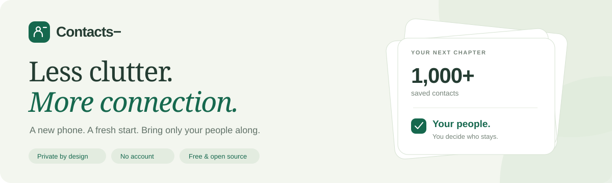

# Contacts−

**Turn a crowded contact backup into a list of people you actually want to keep.**

Import your contacts, choose your people, and download a fresh list. Free to use, with no account and no contact uploads.

[See the mobile preview →](docs/contacts-android-layout.png)

## Why I built it

I bought a new phone and realized I had **1,000+ contacts**, but I rarely connect with more than **100 people**. I wanted a fresh start without carrying years of clutter onto my new phone.

Contacts− came from that moment. It gives you a quiet space to go through your backup, choose who stays, and bring only your people along.

## Built for a fresh start

|                        | What you can do                                                                                                                     |
| ---------------------- | ----------------------------------------------------------------------------------------------------------------------------------- |
| **Bring your backup**  | Import VCF, vCard or Google Contacts-style CSV files, up to 50 MB.                                                                  |
| **Find your people**   | Search names, numbers, emails and companies. Filter and sort your list.                                                             |
| **Choose who stays**   | Select one contact, a page, or all matching results. Keep your selections across searches and pages.                                |
| **Take your time**     | Imports and selections save automatically in your browser. Refresh or return later; **Save progress** confirms your latest choices. |
| **Review the details** | Inspect contacts and duplicate candidates. Undo your last selection change.                                                         |
| **Take them with you** | Preview your selected contacts and download a VCF for your phone's Contacts app.                                                    |
| **Stay in control**    | Clear selections while keeping the list, or clear uploaded contacts and their saved progress.                                       |

Light and dark themes. A responsive layout for desktop and mobile. Your original backup stays untouched.

## Import → choose → export

1. **Bring your contacts.** [Try Contacts−](https://contacts-minus.vercel.app/) and choose a backup from your device. Just exploring? Try the fictional sample contacts inside the app.
2. **Choose your people.** Search, filter and select who you want to keep. Take a break whenever you need; return on the same browser, device and app URL to continue.
3. **Take them with you.** Choose **Export selected**, review the preview, download your VCF and import it through your phone's Contacts app.

Contacts− never edits or deletes contacts directly on your phone. Keep your original backup. Importing an exported file into an existing contact list can create duplicates; import menus and format support vary by phone.

## Your contacts stay yours

Contact parsing, selection and export happen **on your device**. The app has no contact upload endpoint, account system, analytics, advertising or tracking.

Saved progress lives in your current browser. It does not sync between devices, and the app does not encrypt browser storage. Clearing site data or ending a private browsing session can remove your progress. On a shared device, use **Clear uploaded contacts** when you finish.

[Read the privacy policy →](PRIVACY.md)

## Help shape Contacts−

Have an idea or found a bug? [Share your feedback](https://github.com/paritoshpky5/Contacts-/issues). If the app helps you, [give the project a star](https://github.com/paritoshpky5/Contacts-) or [buy me a chai](https://www.buymeachai.in/paritoshpky).

Built with React, TypeScript, Vite and Tailwind CSS. Free and open source under the [MIT license](LICENSE). Developers can find contribution guidance in [CONTRIBUTING.md](CONTRIBUTING.md).

Please use fictional contact data in public reports. Screenshots and [sample files](public/sample-contacts.vcf) in this repository use fictional contacts. See the [security policy](SECURITY.md) to report a security issue.

---

Made with ❤️ in India by **[Paritosh](https://github.com/paritoshpky5)**

  
