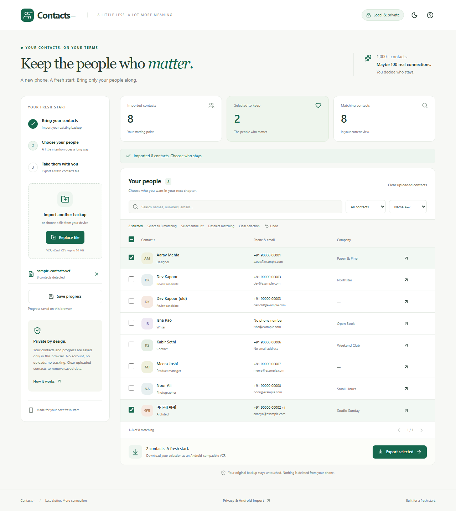

# Contacts−

**Keep the people who matter.** A privacy-first contact manager for a fresh start on your next phone.



## Why I built this

I bought a new phone and realized I had **1,000+ contacts**, but I rarely connect with more than **100 people**. I didn't want years of clutter to follow me onto a new device. I wanted to go through my own backup, choose the people I actually want to keep, and bring just those contacts along.

Contacts− is that small, intentional tool. **You decide who stays.** It never accesses, edits or deletes contacts directly on your phone.

## What you can do

- Import `.vcf`, `.vcard`, or Google Contacts-style `.csv` backups.
- Search names, numbers, emails, companies and job titles; sort and filter your list.
- Select individual contacts, the current page, all matching results, or the entire list. Hidden selections stay intact.
- Inspect details and review duplicate candidates independently. Nothing is merged automatically.
- Undo your most recent selection change, or clear selections without removing the imported list.
- Return after a refresh: imports and selections automatically save **in your current browser**. **Save progress** confirms that the latest state has been written.
- Preview and download only selected contacts as an Android-importable VCF, with a custom filename.
- Use **Clear uploaded contacts** to remove the list, selections and saved progress after confirmation.
- Use a responsive interface with light/dark mode and keyboard-accessible dialogs.

## Run locally

Use Node.js **22.12+** (Node 24 LTS recommended) and npm.

```sh
git clone https://github.com/paritoshpky5/Contacts-.git
cd Contacts-
npm ci
npm run dev
```

The clone command assumes you have created and pushed that GitHub repository. Until then, run the last two commands in this local project folder. Open the local URL printed by Vite, usually `http://localhost:5173`.

To test on an Android phone on the **same Wi-Fi**:

```sh
npm run dev -- --host 0.0.0.0
```

Open the Network URL printed by Vite on the phone, such as `http://192.168.1.8:5173`. If it cannot connect, allow Node through the Windows firewall on your private network. Use a stable URL: browser storage belongs to an origin, so switching between localhost, your LAN address and a deployed domain creates separate saved sessions.

## Import → choose → export

1. Export a backup from your old phone's Contacts app or download a VCF/CSV from Google Contacts. Keep the original backup safe.
2. Choose or drop the backup in Contacts−. An existing list requires confirmation before replacement; invalid imports retain the old list and selections.
3. Search and filter, then check the people you want to keep. The table checkbox changes only the current page of up to 50 contacts. **Select all matching** applies to the whole filtered result, across pages.
4. Use **Save progress** before leaving if you want explicit confirmation. Autosave runs after import and selection changes. Return in the same browser profile and at the same URL.
5. Click **Export selected**, review the preview and warnings, then download the VCF.
6. On Android, open Contacts and find **Organize**, **Manage contacts** or **Settings → Import from file**, then choose the downloaded VCF. Menu labels vary by phone and app.

Importing a file does **not** delete old contacts. Importing into an account that already contains them may create duplicates. Review the destination account and retain a backup before managing existing contacts yourself.

Try [the fictional VCF](public/sample-contacts.vcf) or [the fictional Google-style CSV](public/sample-contacts.csv). All example names and numbers are invented. The app starts empty; sample contacts appear only when explicitly requested.

## Privacy

Parsing, filtering, duplicate review and export happen on your device. The app has **no backend, authentication, analytics, advertising, third-party fonts or contact APIs**. It does not send contact contents over the network or put them into logs, URLs or browser history. Imported strings are rendered as text, not HTML.

To support returning later, it saves the imported records, filename, import warnings and selection IDs in **IndexedDB**, under `contacts-minus`, on this browser profile. Save progress does not upload or download anything. Browser storage is not encrypted by this app. Other people who can use your browser profile can open the saved session. Clearing uploaded contacts deletes the saved record; clearing selection retains the imported contacts. Clearing browser site data also removes saved progress.

Storage can be unavailable or full, particularly in private browsing. Watch the save indicator; if saving fails, export before closing. Saved progress is not a substitute for your original backup. See [PRIVACY.md](PRIVACY.md) for details.

A static hosting provider can receive normal website access metadata. Production security headers are included for hosts supporting `_headers`; GitHub Pages does not apply that file. The application itself does not make contact upload requests.

## Validation

```sh
npm run typecheck
npm test
npm run build
npx playwright install chromium
npm run test:e2e
```

`npm run check` runs type checking, core tests and production build together. Browser tests run against the production preview, using Chromium desktop and Pixel 7 viewport/touch emulation. They cover real file imports through the worker, filtering, selection, downloaded VCF content, confirmation, invalid replacements, details, refresh recovery, clearing, storage and network requests. They regenerate the screenshot files using fictional data. Pixel emulation is **not a physical Android device test**.

Core tests cover vCard boundaries and versions, folding, Unicode, quoted-printable, multiple phones/emails, original property preservation, Google-style CSV quoting/multiline handling, selection scope, export/re-import and operations over 10,000 contacts.

The initial local validation passed **26 core tests and 8 desktop/mobile browser tests**, including a real 5,000-contact import. See [the verification record](docs/VERIFICATION.md) for evidence and the remaining physical-device check.

## Build and deploy

```sh
npm ci
npm run build
npm run preview
```

The deployable static site is in `dist/`. Serve it over HTTP(S), not by double-clicking `index.html`, because imports use a module worker. Vite's relative asset base supports GitHub Pages project URLs.

### Publish the source to GitHub

Git is initialized on `main`. Local commit identity is `paritoshpky5 <ashokkyadav200@gmail.com>`.

Create an empty GitHub repository named **Contacts-** under `paritoshpky5`, without adding a README or license, then run:

```sh
git remote add origin https://github.com/paritoshpky5/Contacts-.git
git push -u origin main
```

If you already have an `origin`, use `git remote set-url origin ...` instead. No remote repository or public deployment is created by the local build.

### GitHub Pages

In **Settings → Pages → Build and deployment**, select **GitHub Actions**. Run the included **Deploy GitHub Pages** workflow manually from the Actions tab. It validates, builds, uploads `dist/` and deploys the site. Subsequent deployment is manual so ordinary source pushes don't unexpectedly publish changes. The anticipated project URL is `https://paritoshpky5.github.io/Contacts-/`; use it in launch copy only after a successful deployment.

### Other static hosts

For Netlify, Cloudflare Pages or similar: use `npm ci && npm run build` as the build command and `dist` as the output directory. No environment variables or server are required. No SPA rewrite is needed because the app uses a single page without client routes. The `public/_headers` file applies protective response headers on compatible hosts.

## Project structure

```text
src/
  App.tsx                     Responsive workflow and session UI
  components/Modal.tsx        Accessible dialog and focus handling
  features/contacts/
    logic.ts                  Search, filtering, sorting, selection, duplicates
    import.worker.ts          Browser-local background parsing
  lib/
    vcard/index.ts            VCF parsing, loss-preserving export, folding
    csv/index.ts              Papa Parse and CSV → vCard mapping
    session.ts                Serialized IndexedDB saves and clearing
  types/contact.ts            Shared models
  tests/contacts.test.ts      Core regression tests
e2e/                          Production-browser workflow tests
public/                       Fictional sample files, favicon, host headers
docs/                         Launch copy and generated screenshots
.github/workflows/            CI and manual GitHub Pages deployment
```

## Format support and limitations

- The vCard parser is a deliberately bounded structural reader, not a complete implementation of every historical extension. Existing VCF records retain original properties, binary data, custom labels and version on export, with CRLF endings. Missing required FN/N fields are added using the display name. Existing VCF line layout is otherwise preserved, including legacy base64 continuation lines.
- Common 2.1/3.0/4.0 records, UTF-8/UTF-16 files, standard folds, escaping and quoted-printable fields are supported. Legacy files with non-UTF-8 bytes outside quoted-printable, malformed boundaries or unsupported versions are rejected. Export a fresh UTF-8 backup for those files.
- CSV export generates folded UTF-8 vCard 3.0. Common names, phones, emails, labels, company, title, birthday, notes, websites, groups and formatted addresses are mapped. Other populated columns become `X-CONTACTS-CSV-*` extension properties; a phone app may not display them. Separate address component columns are preserved as extensions, not combined into a structured postal address. Date strings are retained as supplied.
- Duplicate review uses normalized phone digits, case-insensitive emails and exact normalized names. It does not infer country codes or aggressively fuzzy-match names. Same-name people may be unrelated.
- Contact details hide embedded photos and binary properties, which remain in VCF exports.
- Imports are capped at 50 MB. Rendering uses 50-row pages and parsing uses a worker. Automated logic checks exercise 10,000 contacts; practical speed depends on device and embedded photos.
- Progress stays on one browser/device/origin, does not sync, and is not encrypted by the application. Multiple tabs can overwrite the same saved session; use one working tab. Browser clearing or eviction can remove data. Undo is limited to one selection operation and is not restored after refresh.
- Android import instructions and generated VCF output are provided; compatibility still depends on the target Contacts app. Physical Android import has not been verified in this development environment.

## Share the project

[Launch copy](docs/LAUNCH.md) includes LinkedIn and Product Hunt drafts, a maker comment and a practical launch checklist. Replace the live URL placeholder once your deployment is online. [CONTRIBUTING.md](CONTRIBUTING.md) explains how to contribute safely with fictional test data.

MIT licensed. Built by [paritoshpky5](https://github.com/paritoshpky5).
